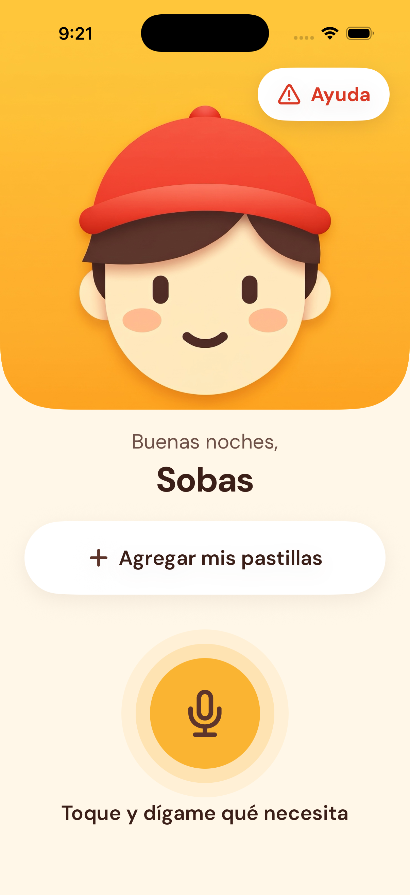
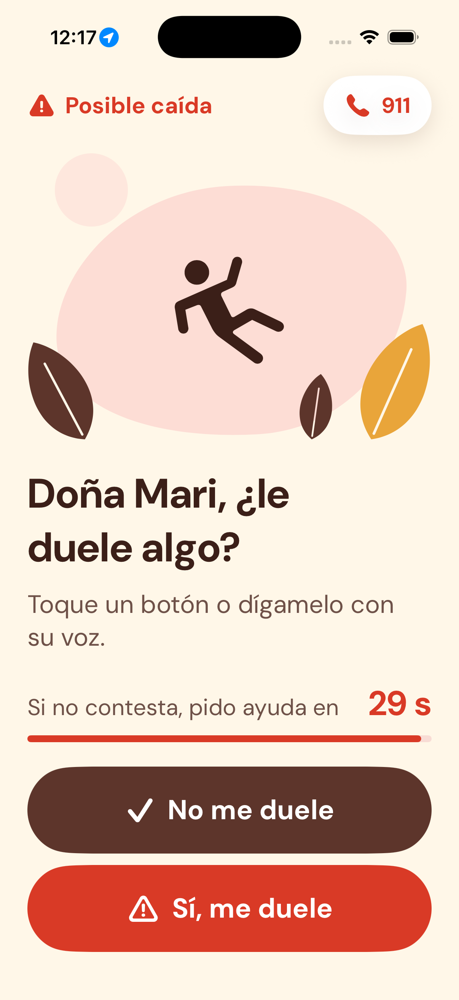
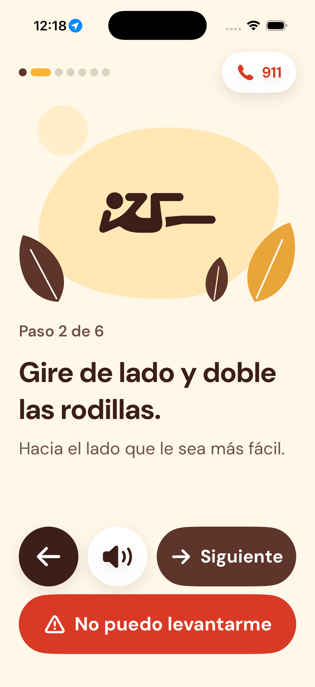
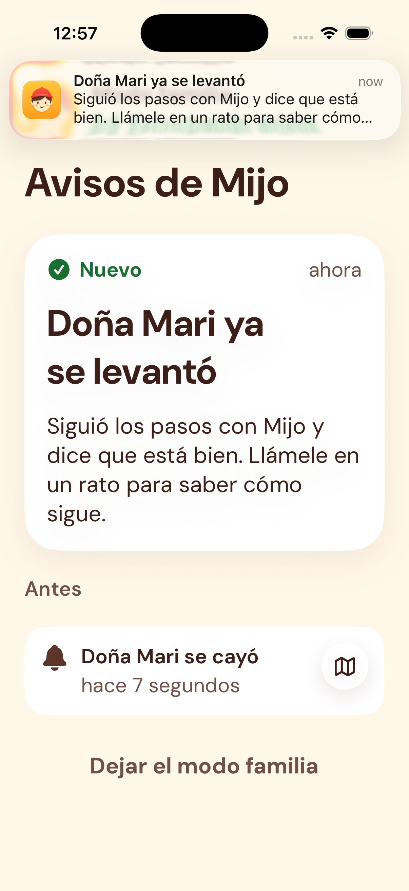

# Mijo · tu nieto en el teléfono

App de iPhone para personas mayores que pasan el día solas. Se le pide con la voz y lo hace, pregunta por la persona aunque no le hable, cuida sus pastillas, la acompaña si se cae y avisa a su familia.

> *"Siri te responde cuando le hablas. Mijo te cuida aunque no le hables."*

Proyecto del **12° Hackathon · FES Acatlán** (9–10 de noviembre de 2026), tema *"Adultos mayores: independientes, conectados y seguros"*. Equipo **Datisa**.

<p>
  
  
  
  
</p>

## El problema
- Las caídas matan a ~842,000 personas al año; el 71 % tiene 60 años o más ([OMS](https://www.who.int/news-room/fact-sheets/detail/falls)).
- 8 de cada 10 personas muy mayores que se cayeron no pudieron levantarse solas, y casi nunca usaron su alarma ([BMJ 2008](https://www.bmj.com/content/337/bmj.a2227.abstract)).
- Solo el 42.1 % de las personas de 65+ en México usa internet ([INEGI, ENDUTIH 2024](https://inegi.org.mx/contenidos/programas/endutih/2024/doc/presentacion_endutih2024.pdf)). Por eso Mijo se usa **hablando**, no tocando menús.

## Qué hace
| Función | Cómo funciona |
|---|---|
| **"Mijo, me caí"** | Protocolo fijo, sin IA. Pregunta "¿le duele algo?". Si no: avisa a la familia con la dirección y guía 6 pasos para levantarse. Si sí, o si no contesta en 30 s: aviso urgente, dice en voz dónde está, abre la llamada y muestra la ficha médica. |
| **Avisos a la familia** | POST a [ntfy.sh](https://ntfy.sh) (público, gratuito, sin cuenta). El familiar recibe la alerta en la app ntfy o en Mijo en "modo familia". |
| **Pídeselo con la voz** | "Recuérdame la pastilla a las 9", "¿ya me tomé la pastilla?", "dile a Pedro que ya comí" (WhatsApp listo), "ponme canciones de Pedro Infante", "¿dónde estoy?". |
| **Mijo pregunta por ti** | Notificaciones con la voz de Mijo ("¿Ya cenó, doña Mari?") que se contestan sin abrir la app. |
| **Sus pastillas de hoy** | Tomada / ahora / sin confirmar, con botón "Ya me la tomé". |
| **Registro por voz** | Nombre, persona de confianza, código QR para conectar a la familia y permisos. Sin cuentas ni contraseñas. |
| **Siri** | Atajos "Habla con Mijo", "Mijo, me caí", "¿ya me tomé la pastilla?". |

### Cómo decide qué hacer
```
Voz → EmergencyRouter ──(emergencia)──▶ protocolo de caída (sin IA)
          │
          ▼
     ComandosDeVoz ──(petición conocida)──▶ MijoActions
          │
          ▼
     MijoAgent (Foundation Models, 3 herramientas) ──▶ MijoActions ──▶ NtfyService
```
1. **Emergencias sin IA:** los filtros de Foundation Models bloquean temas de lesiones y salud, y una emergencia tiene que responder siempre igual.
2. **Peticiones comunes por palabras clave:** en el iPhone, la IA con muchas herramientas las confundía. Así responden al momento.
3. **La IA de Apple solo para platicar**, con 3 herramientas y un límite de 12 s.

## Tecnologías
Solo frameworks de Apple y APIs públicas gratuitas, sin dependencias externas.

Swift · SwiftUI · SwiftData · Foundation Models · Speech · AVFoundation · App Intents · UserNotifications · CoreLocation · MapKit · Contacts · CoreImage · URLSession + ntfy.sh

## Cómo correrla
**Requisitos:** Xcode 26 o posterior, iOS 26. Para la IA hace falta un iPhone con Apple Intelligence (15 Pro o posterior). Voz, llamadas, Siri y ubicación real solo funcionan en el iPhone, no en el simulador.

1. Abre `hackAthon/hackAthon.xcodeproj` en Xcode.
2. En *Signing & Capabilities*, elige tu equipo (sirve un Apple ID gratuito).
3. Corre en tu iPhone (con el Modo desarrollador activado) o en el simulador.

Desde la terminal, para el simulador: `./scripts/build.sh` (compila y abre la app) o `./scripts/build.sh --captura`.

## Estructura
```
hackAthon/hackAthon/
├── Conversation/   escuchar y contestar
├── Help/           protocolo de caída
├── Family/         modo familia
├── Pills/          pastillas del día
├── Onboarding/     registro por voz
├── Intents/        atajos de Siri
├── Services/       voz, agente, comandos, ntfy, ubicación, contactos, notificaciones
├── Models/         SwiftData
└── DesignSystem/   colores, letra DM Sans, componentes
docs/               PRD, pitch, investigación, pruebas en iPhone, capturas
```

## Límites
- Llamar y mandar WhatsApp piden 1 toque: iOS no deja que una app lo haga sola. El aviso por ntfy sí sale solo.
- No detecta caídas por sí misma: la persona lo dice o toca Ayuda.
- Sin cuenta de Apple Developer de pago no hay servidor de notificaciones propio; el modo familia dentro de Mijo solo recibe avisos con la app abierta (ntfy es el respaldo).
- Revisar pastillas o comidas sin confirmar solo funciona con la app abierta.
- Siri a veces entiende "mi hijo" en vez de "Mijo".
- Los pasos para levantarse son orientativos, no consejo médico.

## Siguientes pasos
1. Modo familia con la app cerrada (servidor de notificaciones).
2. Pantalla para que la familia configure pastillas, horarios, ficha médica y familiares.
3. Detección automática de caídas con Core Motion o Apple Watch.
4. AlarmKit para pastillas críticas.
5. La voz de un familiar en los recordatorios.

## Documentación
- [Lo que hicimos](docs/LO_QUE_HICIMOS.md): funciones, estado de cada una y arquitectura.
- [PRD](docs/PRD.md) · [Pitch](docs/PITCH.md) · [Pruebas en iPhone](docs/PRUEBAS_IPHONE.md)
- [Investigación global](docs/INVESTIGACION_GLOBAL.md): amenazas y necesidades de las personas mayores, con fuentes.

## Equipo
- Leo Yahir Carpio Angeles
- Arturo Jaramillo Salmerón
- Sebastian Gonzalo Mera Montiel

Hecho con ayuda de Claude Code (IA permitida por los organizadores).
